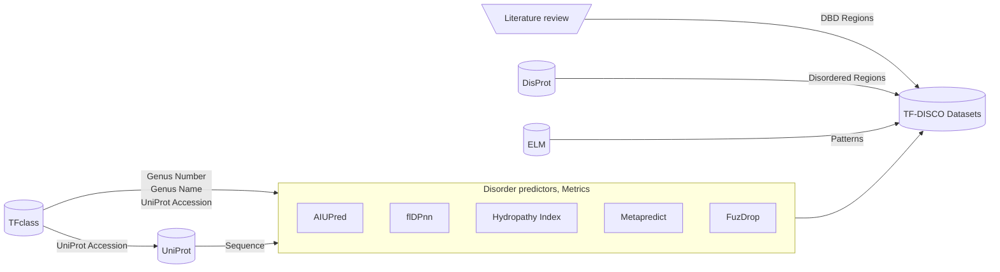
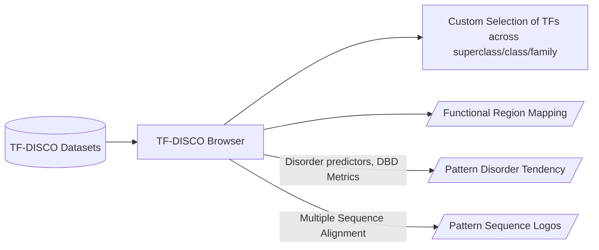
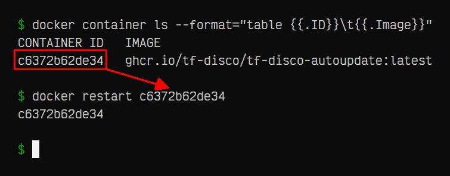

<h1 align="center"><b>TF-DISCO</b></h1>
<p align="center"><sup>A Consolidated database of Disorder, Patterns and Functional annotations of Transcription Factors</sup></p>

This is the Streamlit frontend for the [TF-DISCO Datasets](https://kaggle.com/datasets/joejojoestar/tf-disco-datasets) stored in the accompanying Kaggle repository.

Table of contents:
- [**PIPELINE**](#pipeline)
- [**RUNNING THE APP**](#running-the-app)
  - [1. Docker (best for Deployment)](#1-docker-best-for-deployment)
  - [2. Bare metal (best for Development)](#2-bare-metal-best-for-development)
- [**BUILDING THE APP (DOCKER)**](#building-the-app-docker)
- [**CONFIGURING THE APP**](#configuring-the-app)
- [**AUTHORS**](#authors)
- [**LICENSE**](#license)

> [!IMPORTANT]
> Please read the sections "[RUNNING THE APP](#running-the-app)" and
> "[CONFIGURING THE APP](#configuring-the-app)" first, in order to run the app.


## **PIPELINE**



User workflow:



---

## **RUNNING THE APP**

There are two ways to run the app:

1. [Docker](#1-docker-best-for-deployment) (best for Deployment)
2. [Bare metal](#2-bare-metal-best-for-development) (best for Development)


### 1. Docker (best for Deployment)

This repository contains **two** `Dockerfiles` and their corresponding
[built images](https://github.com/orgs/tf-disco/packages?repo_name=tf-disco),
ready for use.

- The [`tf-disco` image](https://github.com/tf-disco/tf-disco/pkgs/container/tf-disco)
    is built automatically from the [`Dockerfile`](Dockerfile). The image is
    also available on [Docker Hub Mirror](https://hub.docker.com/r/joejojoestar/tf-disco).

- The [`tf-disco-autoupdate` image](https://github.com/tf-disco/tf-disco/pkgs/container/tf-disco-autoupdate)
    is built automatically from the [`Dockerfile.autoupdate`](Dockerfile.autoupdate).
    The image is also available on [Docker Hub Mirror](https://hub.docker.com/r/joejojoestar/tf-disco-autoupdate).

    This image is based on the previous image, with the added feature that it
    will automatically fetch the latest code and Dataset changes from the
    repository, upon startup. This can be used in environments where a
    fully-fledged CI/CD workflow is not available.

To use either of these images, follow the below instructions:

1. Get the [Docker Engine](https://docs.docker.com/engine/install).

2. Pull the pre-built image from one of the following sources, and run it:

    ```bash
    docker pull <IMAGE_URL>
    docker run -it -p 8501:8501 <IMAGE_URL>
    ```

    Choose any one below for `<IMAGE_URL>`. If not sure, choose the
    `joejojoestar/tf-disco:latest` image.

    |                               | **`tf-disco` image**               | **`tf-disco-autoupdate` image**               |
    | ----------------------------- | ---------------------------------- | --------------------------------------------- |
    | **GitHub Container Registry** | `ghcr.io/tf-disco/tf-disco:latest` | `ghcr.io/tf-disco/tf-disco-autoupdate:latest` |
    | **Docker Hub Registry**       | `joejojoestar/tf-disco:latest`     | `joejojoestar/tf-disco-autoupdate:latest`     |

    If you want to build your own image, read the section
    "[BUILDING THE APP (DOCKER)](#building-the-app-docker)" for more info.

> [!TIP]
> To keep TF-DISCO automatically up-to-date, it is recommended to use the
> `tf-disco-autoupdate` image, and simply restart the container periodically. On
> every restart, it'll fetch the latest changes from the main repository.
>
> To restart the container, first run the following command to fetch its ID:
>
> ```bash
> docker container ls --format="table {{.ID}}\t{{.Image}}" # to get the container ID
> ```
>
> Then, run the following command to restart the container.
> ```bash
> docker restart <CONTAINER_ID>
> ```
>
> Here is a sample on how it's supposed to look like:
> 


### 2. Bare metal (best for Development)

Use this method only if containers are not feasible for your setup, or if you're
developing / contributing changes to this project (in which case, thanks for
your effort!).

1. Clone the repo
    ```bash
    git clone https://github.com/tf-disco/tf-disco.git
    cd tf-disco/
    ```

2. Create an environment (highly recommended) and install requirements. Python
   3.13 is recommended.

   1. ... using **venv** (ensure you already have Python 3.13 on your system):
        ```bash
        python -m venv .venv
        .venv/Scripts/activate
        pip install -r requirements.txt
        ```

   2. ... using **uv** ([install instructions](https://docs.astral.sh/uv/getting-started/installation)):
        ```bash
        uv sync
        .venv/Scripts/activate
        ```

        Read more at the [uv docs](https://docs.astral.sh/uv/pip/environments/#discovery-of-python-environments)
        about choosing an existing environment, if needed.

   3. ... using **Conda** ([install instructions](https://anaconda.com/docs/getting-started/miniconda/install/overview)):
        ```bash
        conda create -n tf-disco python=3.13
        conda activate tf-disco
        pip install -r requirements.txt
        ```

3. Start Streamlit!
    ```bash
    streamlit run app.py
    ```


---

## **BUILDING THE APP (DOCKER)**

> [!NOTE]
> - This section is relevant only for Docker builds.
> - To build for the auto-update variant, add `-f Dockerfile.autoupdate` to the
>   `build` command.

First, clone the repo locally:
```bash
git clone https://github.com/tf-disco/tf-disco.git
cd tf-disco/
```

Then, there are three ways to **build** the images from the Dockerfile,
depending on how you want to bundle the Dataset:

1. Baking the Dataset from **Kaggle** directly in the Image:
    ```bash
    docker build -t tf-disco --build-arg dataset_source=kaggle .
    docker run -it --name tf-disco -p 8501:8501 tf-disco
    ```

2. Baking the **locally-available Dataset** directly in the Image:
    ```bash
    docker build -t tf-disco --build-arg dataset_source=copy --build-context dataset_path=/local/path/to/Datasets/ .
    docker run -it --name tf-disco -p 8501:8501 tf-disco
    ```

3. **Mounting** a Dataset from a local directory (during runtime) in the Image:
    ```bash
    docker build -t tf-disco --build-arg dataset_source=mount .
    docker run -it --name tf-disco -p 8501:8501 -v /local/path/to/Datasets:/tf-disco-dataset tf-disco
    ```

    Keep in mind that, to reiterate, this 3rd method does **not** bake the
    Dataset inside the image, and it is expected to be mounted during runtime.

---

## **CONFIGURING THE APP**

You can set certain configuration options in the [.env file](.env) before you
start the app.

Note that these options are considered only when running bare metal, and are
**ignored in Docker**. If you're running in Docker, consider modifying the
Dockerfiles directly to set your environment variables.

If you have the Dataset locally available (e.g. you've already downloaded the
Dataset from Kaggle, or if you have a custom Dataset), set this variable to
override the Dataset path:

> [!NOTE]
> If you are running in Docker, then provide the path via the
> `--build-arg dataset_path=...` argument to `docker build` instead. Read the
> section "[BUILDING THE APP (DOCKER)](#building-the-app-docker)" for more info.

```bash
DATASET_PATH_OVERRIDE="path/to/dataset/"
```

If you are running Linux x86, then the app will automatically download the
MUSCLE v5 binary. If you are running any other OS / architecture, please visit
<https://github.com/tf-disco/muscle/releases> and download the appropriate
binary. ([more info](https://github.com/tf-disco/tf-disco/issues/5))

> [!NOTE]
> - Ensure to get the MUSCLE v5 binary. MUSCLE v3 binary is not compatible.
> - If you are running in Docker, the below variable will be ignored, as the
>   MUSCLE v5 binary is already bundled with it.

```bash
MUSCLE_PATH="path/to/muscle-win64.v5.3.exe"
```

---

## **AUTHORS**

This web app is developed by:
- Joseph Cijo ([GitHub](https://github.com/joejo-joestar), [LinkedIn](https://linkedin.com/in/joseph-cijo), [email](mailto:joecn2704+tfdisco@gmail.com))
- Sreenikethan Iyer ([GitHub](http://github.com/SreenikethanI), [LinkedIn](https://linkedin.com/in/sreenikethan-i), [email](mailto:sreeni.s.iyer+tfdisco@gmail.com))

## **LICENSE**

This project is licensed under the [MIT License](LICENSE).
